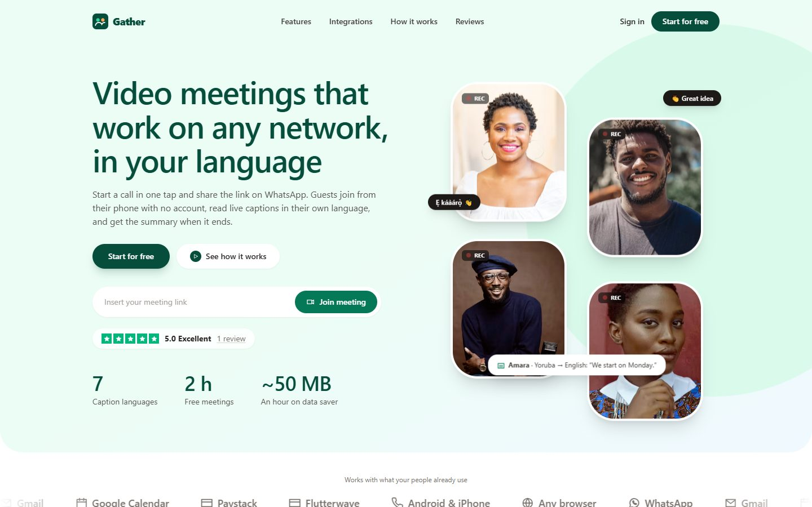

# Nonso John Anigbogu · Portfolio

**Full-stack developer** in Awka, Nigeria · React · TypeScript · Node.js · Python · PHP/Laravel

**Live site: [anigbogujohn.github.io](https://anigbogujohn.github.io)** · [Download my CV](assets/cv/Nonso_Anigbogu_CV.pdf) · [Email](mailto:nonsoanigbogu49@gmail.com) · [WhatsApp](https://wa.me/2349160599477)



I build complete web products, from the interface to the database: real-time video, AI that cites its sources, payments, WhatsApp messaging and cloud deployment, built for African networks and users.

## Featured projects

| Project | What it is | Stack | Links |
|---|---|---|---|
| **Gather** | Video meetings for weak mobile networks, with live captions in 7 languages and AI summaries sent by WhatsApp | React, TypeScript, Node.js, Socket.IO, Python FastAPI, PostgreSQL, LiveKit/WebRTC | [Live](https://gather-44mh.onrender.com) · [Code](https://github.com/AnigboguJohn/Gather) |
| **RegRadar** | AI compliance assistant that answers questions about Central Bank of Nigeria rules with exact citations | React, Node.js, Python FastAPI, PostgreSQL + pgvector, Terraform, AWS | [Live](https://regradar-kur5.onrender.com) · [Code](https://github.com/AnigboguJohn/regradar) |
| **Tranyer** | Multi-vendor marketplace in 8 languages and 7 currencies | React, TypeScript, Tailwind, shadcn/ui, Supabase | [Live](https://tranyer.vercel.app) · [Code](https://github.com/AnigboguJohn/Tranyer-Project) |
| **ADF Magazine** | Responsive defence news magazine website | HTML, Sass, JavaScript | [Live](https://anigbogujohn.github.io/blog_web_design/) · [Code](https://github.com/AnigboguJohn/blog_web_design) |
| **My Recipes Book** | Mobile-first recipe app: search, categories, saved recipes, ratings and step-by-step cooking mode with timers | PHP 8.3, Laravel 12, Blade, SQLite, Docker | [Live](https://recipes-app-7qw7.onrender.com) · [Code](https://github.com/AnigboguJohn/Recipes_App_Laravel) |
| **Switch** | Esusu-style savings and loans platform with OTP sign-up | PHP, MySQL | [Code](https://github.com/AnigboguJohn/Switch) |

## About this site

Hand-written HTML, CSS and JavaScript: no framework and no build step, so it loads fast on slow connections.

- Dark and light themes (remembered per visitor)
- Featured-projects slider, project filters and a details pop-up for each project, with a screenshot gallery, features, stack and folder layout
- Scroll animations that switch off for visitors who prefer reduced motion
- Contact form that opens WhatsApp or email with the message filled in, so no server is needed
- Works on phones from 360px wide, keyboard friendly, hosted free on GitHub Pages

```
portfolio/
├─ index.html                     the page
├─ assets/
│  ├─ css/style.css               design: tokens, dark/light themes, phone layout
│  ├─ js/data.js                  all content: projects, services, skills, work history
│  ├─ js/main.js                  menu, theme, slider, filters, project pop-up, form
│  ├─ cv/Nonso_Anigbogu_CV.pdf
│  ├─ icons/favicon.svg
│  └─ images/
│     ├─ profile/                 profile photo
│     └─ projects/                screenshots: gather/, regradar/, tranyer/, recipes/, adf-magazine/
├─ vercel.json                    optional Vercel hosting settings
└─ README.md
```

## Contact

- **Email:** [nonsoanigbogu49@gmail.com](mailto:nonsoanigbogu49@gmail.com)
- **WhatsApp:** [+234 916 059 9477](https://wa.me/2349160599477)
- **Phone:** +234 808 527 6954
- **GitHub:** [github.com/AnigboguJohn](https://github.com/AnigboguJohn)

Open to full-time roles, contracts and freelance projects.

---

<details>
<summary><b>Editing and hosting notes</b></summary>

**Run it locally:** double-click `index.html`. Nothing to install.

**Change the content:** all the text on the page is in `assets/js/data.js`. Edit it and refresh.
To add a screenshot, put the image in the project's folder under `assets/images/projects/` and add it to that project's `gallery` list.

**Profile photo:** save a portrait as `assets/images/profile/profile.jpg` (about 840 × 1040 pixels). Until then a placeholder is shown.

**Hosting (GitHub Pages):** Settings → Pages → Source: "Deploy from a branch" → `main` / root. Every push updates the site within a minute or two.

**Hosting (Vercel, optional):** import this repository on vercel.com, choose the "Other" preset and leave the build command empty.

</details>
